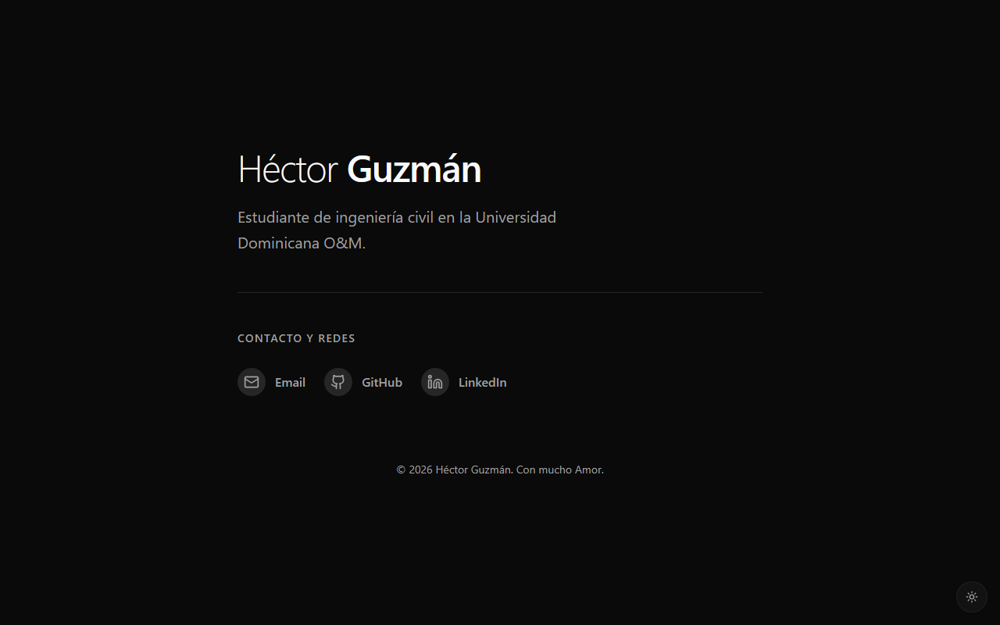

# Héctor Guzmán — Portafolio

Portafolio personal minimalista de Héctor Guzmán, estudiante de ingeniería civil en la Universidad Dominicana O&M.

[](https://hectorguzmanr.github.io/Pagina-web-ABOUT-ME/)

## Demo

**https://hectorguzmanr.github.io/Pagina-web-ABOUT-ME/**

## Stack

- React 19 + TypeScript
- Vite 6
- Tailwind CSS v4 (`@tailwindcss/vite`)
- Motion (`motion/react`) con respeto a `prefers-reduced-motion`
- Modo oscuro con interruptor sol/luna; sigue al sistema hasta que lo cambias y guarda la elección en `localStorage`. Transición de colores de 300 ms y cruce animado del icono
- Lucide React
- GitHub Pages + GitHub Actions

## Desarrollo local

**Requisitos:** Node.js 22 o superior.

```bash
npm install
npm run dev
```

Abre **http://localhost:3000**. El servidor recarga la página automáticamente (HMR) al guardar cambios.

## Scripts

| Comando | Descripción |
| --- | --- |
| `npm run dev` | Servidor de desarrollo en el puerto 3000 (HMR) |
| `npm run build` | Compila el sitio a `dist/` |
| `npm run preview` | Sirve el build de producción en el puerto 4173 |
| `npm run lint` | Verifica los tipos con `tsc --noEmit` |
| `npm run clean` | Borra `dist/` (multiplataforma, vía Node) |

## Estructura

```
.
├── public/                 # favicon, apple-touch-icon, og-image, robots.txt, sitemap.xml
├── src/
│   ├── App.tsx             # Contenido y animaciones del portafolio
│   ├── ThemeToggle.tsx     # Interruptor de tema con persistencia
│   ├── index.css           # Tailwind + prefers-reduced-motion
│   └── main.tsx            # Punto de entrada de React
├── index.html              # Metadatos SEO, Open Graph, JSON-LD y noscript
├── .github/workflows/      # Despliegue automático a GitHub Pages
├── package.json
└── vite.config.ts
```

## Despliegue

Cada push a `main` ejecuta `.github/workflows/deploy.yml`:

1. Instala las dependencias con `npm ci` (versiones fijadas por `package-lock.json`).
2. Verifica los tipos con `npm run lint`.
3. Compila con `npm run build`.
4. Publica `dist/` en GitHub Pages.

En GitHub, revisa una vez: **Settings → Pages → Build and deployment → Source = GitHub Actions**.

## Notas

- Las dependencias están fijadas en `package-lock.json`; no edites ese archivo a mano.
- El SEO y la vista previa social están configurados en `index.html`. La imagen para compartir es `public/og-image.png` (1200×630).
- El modo oscuro sigue al sistema por defecto. El interruptor de la esquina inferior derecha permite cambiarlo; la elección se guarda en `localStorage` y se aplica antes del primer render para evitar parpadeos. El cambio anima los colores (300 ms) y cruza sol/luna con rotación; con `prefers-reduced-motion` los colores siguen fundiéndose y el icono solo se desvanece, sin rotación.
- `robots.txt` y `sitemap.xml` apuntan a la URL de GitHub Pages. Al usar un dominio propio hay que actualizar `canonical`, `og:url`, `og:image`, `sitemap.xml` y `robots.txt`.
